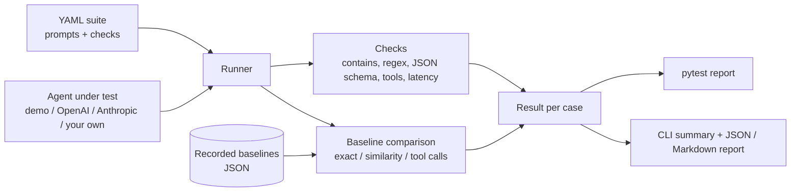

# LLM Eval Agent

[](https://github.com/AmanSharma898/LLM_Agent/actions/workflows/ci.yml)


**An automated non-regression testing framework for LLM agents, built on Python and pytest.**

When you change the model, the prompt or the tools of an LLM agent, its behaviour can
change in ways nobody notices until a user does. LLM Eval Agent turns the expected
behaviour into reproducible test cases, records known-good answers as baselines, and
fails the build when a later version behaves differently.

> 🇩🇪 Eine deutsche Kurzfassung steht [weiter unten](#kurzfassung-auf-deutsch).

---

## Features

- **Declarative test cases in YAML**: one prompt plus a list of checks per case, no code needed.
- **Check library**: `contains`, `not_contains`, `equals`, `regex`, `json_schema`,
  `tool_called`, `no_tool_called`, `max_chars`, `max_latency_s`. New checks are one decorated function.
- **Baseline snapshots**: record the answers of a known-good agent, then flag *drift* on later runs
  (exact match or similarity threshold, plus a check that the sequence of tool calls is unchanged).
- **pytest plugin**: every YAML case becomes a pytest test, so you get `-k`, `-m <tag>`, `-x`,
  JUnit XML and IDE integration for free.
- **CLI with reports**: `llm-eval run` prints a summary and writes JSON and Markdown reports;
  the exit code makes it CI-ready.
- **Provider-agnostic**: anything that implements `run(prompt) -> AgentResponse` can be tested.
  Adapters for OpenAI-compatible APIs and Anthropic are included as optional extras.
- **Runs offline**: a deterministic demo agent lets the whole workflow, the test suite and CI run
  without API keys.
- **Code quality**: fully typed (`mypy --strict`), linted and formatted with Ruff, tested on
  Python 3.10 to 3.13 in GitHub Actions.

## How it works



Two layers catch two kinds of problems:

1. **Checks** encode what must always be true (the answer contains the right number, the output
   is valid JSON, the right tool was called).
2. **Baselines** catch everything you did not think to write a check for: if the answer to a
   prompt suddenly looks different from the recorded known-good answer, the case fails and the
   report shows the difference. Intended changes are accepted by re-recording the baseline.

<!-- Screenshot placeholder: add a screenshot of a failing pytest run or of the CI job summary here.

-->

## Quick start

```bash
git clone https://github.com/AmanSharma898/LLM_Agent.git
cd LLM_Agent
python -m venv .venv && source .venv/bin/activate   # Windows: .venv\Scripts\activate
pip install -e ".[dev]"
```

Run the example suite against the demo agent. The committed baselines were recorded with
version `v1`, so everything passes:

```console
$ llm-eval run examples/suites/eval_assistant.yaml --agent demo:v1 --baselines examples/baselines
Suite 'assistant' with agent 'demo:v1'
  [PASS] simple_addition
  [PASS] division_keeps_decimals
  [PASS] division_by_zero_is_handled
  [PASS] km_to_miles
  [PASS] order_lookup_returns_json
  [PASS] unknown_order
  [PASS] out_of_scope_request
7/7 passed, 0 drift, 0 missing baseline
```

Now simulate a model or prompt update. Demo agent `v2` answers in a different style and rounds
results, and the framework flags it:

```console
$ llm-eval run examples/suites/eval_assistant.yaml --agent demo:v2 --baselines examples/baselines
Suite 'assistant' with agent 'demo:v2'
  [FAIL] simple_addition
         - baseline drift (similarity 0.56): 'The result is 5.' -> 'Result: 5'
  [FAIL] division_keeps_decimals
         - contains: missing: ['2.50']
         - baseline drift (similarity 0.50): 'The result is 2.50.' -> 'Result: 2'
  [PASS] division_by_zero_is_handled
  [FAIL] km_to_miles
         - regex: no match for /6\.21 miles/
  [PASS] order_lookup_returns_json
  [PASS] unknown_order
  [PASS] out_of_scope_request
4/7 passed, 2 drift, 0 missing baseline
```

Note how the layers complement each other: `simple_addition` passes all its explicit checks and
is caught only by the baseline, while `km_to_miles` is similar enough to its baseline (0.92) and
is caught only by its `regex` check.

The same suite also runs as plain pytest tests:

```bash
pytest examples/suites --llm-agent demo:v1 --llm-baselines examples/baselines
pytest examples/suites --llm-agent demo:v2 --llm-baselines examples/baselines -m smoke
```

## Writing a suite

Suite files are YAML. For pytest to collect them, name them `eval_*.yaml`.

```yaml
name: assistant
system_prompt: You are a helpful assistant ...   # passed to API-based agents

defaults:                # applied to every case unless overridden
  baseline: similarity   # exact | similarity | off
  threshold: 0.9         # minimum similarity for "similarity" mode

cases:
  - id: order_lookup_returns_json
    prompt: What is the status of order 42?
    tags: [orders, smoke]          # usable with --tag (CLI) or -m (pytest)
    baseline: exact
    checks:
      - tool_called: order_lookup
      - json_schema:
          type: object
          required: [order_id, status]
```

See [`examples/suites/eval_assistant.yaml`](examples/suites/eval_assistant.yaml) for a complete suite.

## The non-regression workflow

```bash
# 1. Record baselines from the current, known-good agent
llm-eval record my_suite.yaml --agent openai:<model> --baselines baselines/

# 2. Change the model, prompt or tools, then run again
llm-eval run my_suite.yaml --agent openai:<new-model> --baselines baselines/ \
    --markdown reports/report.md --json reports/report.json

# 3. Review the drift. If a change is intended, re-record (step 1) and commit the new baseline.
```

Baselines are plain JSON files, so changes to expected behaviour show up in code review as a diff.

## Testing a real LLM agent

```bash
pip install -e ".[openai]"      # or ".[anthropic]"
export OPENAI_API_KEY=...       # or ANTHROPIC_API_KEY
llm-eval run my_suite.yaml --agent openai:<model-name>
llm-eval run my_suite.yaml --agent anthropic:<model-name>
```

To test your own agent (for example one built with a framework or with custom tools), implement
the `Agent` protocol:

```python
from llm_eval_agent import AgentResponse, ToolCall, BaselineStore, load_suite, run_suite


class MyAgent:
    name = "my-agent:v3"

    def run(self, prompt: str) -> AgentResponse:
        text, calls = my_existing_agent(prompt)  # your code
        return AgentResponse(text, [ToolCall(c.name, c.args) for c in calls])


result = run_suite(MyAgent(), load_suite("my_suite.yaml"), BaselineStore("baselines"))
assert result.passed
```

LLM outputs are not always deterministic. For API agents, use `temperature=0` (the included
OpenAI adapter does this), prefer structural checks (`json_schema`, `tool_called`, `regex`) over
exact text, and use `similarity` baselines with a threshold that fits your use case.

## Project structure

```
src/llm_eval_agent/
├── agents.py         # Agent protocol, deterministic DemoAgent, OpenAI and Anthropic adapters
├── cases.py          # YAML suite loading and validation
├── checks.py         # check library and registry
├── baseline.py       # baseline storage and drift detection
├── runner.py         # runs a suite, collects CaseResult / SuiteResult
├── report.py         # console, JSON and Markdown reports
├── cli.py            # `llm-eval run` / `llm-eval record`
└── pytest_plugin.py  # collects eval_*.yaml files as pytest tests
examples/
├── suites/           # example YAML suite
└── baselines/        # baselines recorded with demo:v1
tests/                # unit tests for every module, including the pytest plugin
.github/workflows/    # CI: lint, type check, tests, non-regression demo
```

## Development

```bash
pip install -e ".[dev]"
ruff check . && ruff format --check .
mypy
pytest
```

The CI pipeline runs these on Python 3.10 to 3.13 and then runs the non-regression demo: the `v1`
agent must pass, and the `v2` agent must be flagged. Both reports are published to the GitHub
Actions job summary and uploaded as artifacts.

## Roadmap

- [ ] Multi-turn conversation test cases
- [ ] Repeated runs per case with pass-rate thresholds for non-deterministic agents
- [ ] Semantic similarity (embeddings) and LLM-as-a-judge checks
- [ ] HTML report with side-by-side diffs

## Kurzfassung auf Deutsch

**LLM Eval Agent** ist ein automatisiertes Non-Regression-Testing-Framework in Python und pytest
zur systematischen Evaluierung von LLM-Agenten.

- Testfälle werden deklarativ in YAML beschrieben: Prompt plus Prüfungen wie `contains`, `regex`,
  JSON-Schema, erwartete Tool-Aufrufe oder Latenzgrenzen.
- Antworten einer bekannten, guten Agentenversion werden als **Baseline** gespeichert. Spätere Läufe
  werden damit verglichen (exakt, über eine Ähnlichkeitsschwelle und anhand der Tool-Aufrufe), sodass
  Verhaltensänderungen nach Modell- oder Prompt-Anpassungen automatisch und reproduzierbar erkannt werden.
- Ein **pytest-Plugin** macht jeden YAML-Testfall zu einem pytest-Test; die **CLI** erzeugt JSON- und
  Markdown-Berichte und liefert einen CI-tauglichen Exit-Code.
- Anbieterunabhängig: Adapter für OpenAI-kompatible APIs und Anthropic, eigene Agenten über ein
  einfaches Interface. Ein deterministischer Demo-Agent ermöglicht Tests und CI ohne API-Schlüssel.
- Fokus auf Codequalität: vollständig typisiert (mypy strict), Ruff, Unit-Tests für alle Module,
  GitHub Actions auf Python 3.10 bis 3.13.

## License

[MIT](LICENSE)
